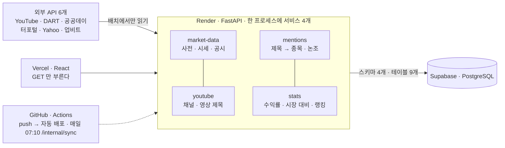

---
# HINDSIGHT 발표 — Markdown 판 (Slidev 형식)
# 발표는 index.html(웹 발표 페이지)로 한다. 이 파일은 같은 내용을 Markdown 으로 적은 것으로,
# `npx slidev slides.md` 로 바로 열리고, Reveal.js(마크다운 모드)·Marp 로도 큰 수정 없이 변환된다.
# 숫자는 2026-10-17 확정 데이터(data/snapshot.json). 발표 페이지는 API 가 깨어 있으면 실시간으로 덮어쓴다.
theme: default
title: HINDSIGHT — 유튜버가 오른다고 한 종목, 정말 올랐을까?
titleTemplate: '%s · 5조'
transition: fade
aspectRatio: 16/9
fonts:
  sans: Pretendard
layout: cover
---

# 유튜버가 오른다고 한 종목,<br>정말 올랐을까?

**HINDSIGHT** · KAIST 디지털금융MBA · 클라우드컴퓨팅실습 · 5조

김지환 · 김현준 · 오선호 · 조인성 · 채재희

<!-- transition: zoom · 오른쪽에 img/story-1.webp -->

<v-click>

**hindsight** /ˈhaɪnd.saɪt/ — 뒤늦은 깨달음, 지나고 나서야 보이는 것

</v-click>

---
layout: default
---

# 오늘 이야기할 순서

1. **쇼릴** — 1분 16초로 보는 HINDSIGHT
2. **문제와 답** — 왜 만들었나 · 무엇을 세나
3. **데이터 · API** — 공개 API 6개 · 채널 선정 · 파이프라인
4. **아키텍처** — 구조 · 요청 한 번의 흐름 · 막혔던 것과 고친 것
5. **분석 결과** — 정말 올랐을까 · 발견 · 한계
6. **활용** — 한 문장 · 누가 어떻게 쓰나
7. **마무리** — 주소 3개 · 부록(DB · API 문서)

---
layout: iframe
url: ./showreel.html?once&embed&short
---

<!-- 3. 쇼릴 — 화면 가득. Space 멈춤 · R 처음부터 -->

---
layout: two-cols
---

# 유튜브의 "오른다"는 전망, 적중률을 아무도 재지 않았다

| 애널리스트 리포트 | 주식 · 코인 유튜브 |
|---|---|
| 적중률을 보여주는 서비스 **있다** | **없다** — 자극적인 제목 · 조회수 수십만 |

<v-click>

그래서 **공개된 데이터**를 모아 정제해서, 오늘 그 결과를 보여 드립니다

</v-click>

<!-- 오른쪽에 img/story-2.webp -->

---

# "오른다"고 한 영상 하나하나를 **사건**으로 보고, 그 뒤 주가를 전부 센다

YouTube 제목 · 게시 시각 → 종목 · 논조("삼전" → 삼성전자 · 낙관만) → 시세 · 공시 → **5 · 20 · 60거래일 수익률 · 시장 대비**

<v-click>

| 51 | 45,660 | 19,016 | 13,609 |
|---|---|---|---|
| 채널 | 영상 제목 · 1년 | "오른다"고 한 언급 | 종목 언급의 20거래일 성적표 (업종 4,060 별도) |

</v-click>

<v-click>

홈 · 지금 뜨는 종목 — 언급 뒤에 · 전체 성적표 — 채널 · 누가 맞았나 — 종목 · 주가 위 언급 시점 — 데이터 · 출처와 가공

</v-click>

---

# 공개 API 6개, 각각 다른 질문에 답한다

| 출처 | 기관 | 답하는 질문 | 받는 것 |
|---|---|---|---|
| YouTube Data API v3 | Google | 누가 언제 무슨 종목을 말했나 | 채널 · 제목 · 게시일 · 조회수 |
| DART 기업코드 | 금융감독원 | "삼전"이 어느 종목인가 | 상장사 3,998개 → 종목 사전 |
| 주식시세정보 V2 | 공공데이터포털 · 금융위원회 | 그 뒤 주가는 | 국내 종가 · 거래량 |
| Yahoo Finance | Yahoo | 시장이 오른 덕인가 | 미국 시세 · 코스피 · S&P500 · 업종 ETF 20 |
| 업비트 Open API | 두나무 | 코인은 | KRW 마켓 294 · 일봉 |
| DART 공시검색 | 금융감독원 | 공시를 따라간 건가 | 공시 49,099건 |

<!-- URL · 수집 항목 · 갱신 주기: docs/data-sources.md -->

---

# 채널은 사람이 고르지 않았다

**547** YouTube 검색 후보 → **272** 구독자 · 업로드 · 쇼츠 · 언급률 측정 → **51** 채택 (주식 38 · 코인 13)

<v-click>

| A · 대형 영향력 | B · 종목 집중 |
|---|---|
| 구독자 **100만** 이상 · 언급률 15% 이상 | 언급률 **30%** 이상 · 구독자 주식 5만 · 코인 10만 이상 |

</v-click>

<v-click>

**언급률** = 최근 50편 제목 중 종목이 나온 비율 · 둘 중 하나만 넘으면 채택 · 30% 하나로 자르면 삼프로TV·김작가TV가 빠진다

</v-click>

---

# 제목 한 줄이 통계가 되기까지 — 매일 07:10 GitHub Actions

| ① 수집 | ② 사전 | ③ 매칭 · 논조 | ④ 시세 · 공시 | ⑤ 수익률 |
|---|---|---|---|---|
| **45,660** 영상 제목 | **4,362** 종목 · 코인 · 테마 | **65%** 성공률 · 낙관 19,016 | **290,175** 시세 행 · 공시 49,099 | **50,170** 언급별 5 · 20 · 60일 |

<v-click>

매칭 26% → 65% · 업종 테마 사전 — 사건일 = 영상 뒤 처음 거래할 수 있는 날 — 오탐은 규칙 + 테스트 18개

</v-click>

---

# Vercel · Render · Supabase · GitHub Actions



<!-- 스키마 4개 · OpenAPI 명세 4개 · 서로는 REST 로만 · 읽기 GET /v1/* · 쓰기 /internal/sync(토큰) · 무료 512MB → 프로세스 5개를 1개로(95MB) -->

---

# 읽기는 GET, 쓰기는 배치만 — 외부 API 는 요청 때 부르지 않는다

**요청 한 번** — 화면이 숫자 하나를 받기까지

```http {1|2|3|4|all}
GET /stats/v1/summary?scope=overall&horizon=20&stance=bull   # 브라우저 · React (Vercel)
key = "bull:overall:20"                                       # FastAPI · stats (Render)
SELECT value FROM stats.summaries WHERE key = 'bull:overall:20'  -- PostgreSQL (Supabase) · 1 row
200 OK · JSON 0.6KB · Cache-Control: max-age=600              # ← 화면
```

<v-click>

**하루 한 번** — 매일 07:10 · 10/17 확정

```http {1|2|3|all}
POST /{service}/internal/sync   X-Internal-Token: ***         # GitHub Actions · cron · 토큰은 Secrets
① 수집 → ② 사전 → ③ 매칭 → ④ 시세 · 공시 → ⑤ 수익률          # FastAPI · 외부 API 6개 읽기
INSERT … · summaries 8,673행 갱신                             # 쓰기는 여기뿐
```

</v-click>

---

# 세 번 막혔고, 세 번 고쳤다

<v-clicks>

- **제목에서 종목을 26%밖에 못 찾았다** → 못 잡은 제목 1,304건을 직접 읽음 → 업종 얘기였다 → 업종 테마 사전 20개 → **65%**
- **"급등했던 이유"가 낙관으로 잡혔다** → 지난 일 해설은 전망이 아니다 → 과거 단서만 있으면 중립 → **1,284건** 제외
- **무료 서버 512MB 가 터졌다** → 프로세스 5개가 기본 350MB → 한 프로세스에 마운트 · DART 스트리밍 파싱 → **95MB**

</v-clicks>

그 밖에 Supabase 연결 15개 한도 · 공공데이터포털 "미등록 키" · 뉴스 크롤링을 넣었다 뺀 것 — 질문 주시면

<!-- 강의계획서 평가 기준: "실패한 실험도 원인과 개선 과정을 설명하면 평가에 반영" -->

---
transition: slide-left
---

# "오른다"고 한 뒤, 실제로는

| 5거래일 뒤 · n=14,385 | 20거래일 뒤 · n=13,609 | 60거래일 뒤 · n=11,467 |
|---|---|---|
| **−1.0%** 평균 · 상승 43% · 시장 대비 −1.2% | **−2.6%** 평균 · 상승 42% · 시장 대비 −2.9% | **−2.6%** 평균 · 상승 38% · 시장 대비 −4.6% |

<v-click>

낙관 언급 뒤 20거래일 수익률 분포 (파랑 하락 · 빨강 상승)

| ≤ −20% | −20~−10 | −10~−5 | −5~0 | 0~5 | 5~10 | 10~20 | ≥ 20% |
|---|---|---|---|---|---|---|---|
| 2,370 | 1,945 | 1,692 | 1,827 | 1,572 | 1,436 | 1,505 | 1,262 |

</v-click>

---
transition: slide-left
---

# 시장은 모두 같은 방향, 채널은 다르다

| 20거래일 뒤 | 표본 | 평균 | 상승 | 시장 대비 | 거래량 |
|---|---|---|---|---|---|
| 전체 | 13,609 | −2.6% | 42% | −2.9% | 0.924배 |
| 국내 | 6,660 | −3.4% | 42% | −4.2% | 0.905배 |
| 미국 | 3,708 | +0.5% | 47% | −0.7% | 0.947배 |
| 코인 | 3,241 | −4.6% | 36% | −3.0% | 0.89배 |
| 업종 · 테마 | 4,060 | +1.7% | 52% | −2.7% | 0.951배 |

시장 대비 TOP 3: 안정모의 주식투자 **+4.6%p** · 미국주식의 모든것 - 미주모 +4.4%p · 김작가 TV +2.7%p
BOTTOM 3: 민박사 **−18.0%p** · 주식전망TV −11.3%p · 주식홀인원 −5.6%p (낙관 30건 · 10종목 이상)

---
transition: slide-left
---

# 숫자가 말해 준 다섯 가지

<v-clicks>

- **−2.6%** — 내린 쪽이 많았다 (20거래일 평균 · 상승 확률 42% · n=13,609)
- **−2.9%p** — 시장도 못 따라갔다 (시장을 이긴 비율 38%)
- **0.924배** — 관심이 먼저, 유튜브는 뒤따른다 (언급 뒤 5일 ÷ 앞 20일 거래량)
- **−1.2% → −4.6%p** — 오래 들수록 시장과 더 벌어진다 (5일 → 20일 → 60일 시장 대비)
- **25%** — 대부분은 공시와 무관했다 (국내 언급 중 사건일 ±3일에 주요 공시가 있던 비율)

</v-clicks>

---

# 이 숫자가 말하지 않는 것, 두 가지

<v-clicks>

1. **제목만 봤다** — 자막·설명은 안 봤고, 낙관·비관은 단어 사전으로 가른다. 낙관 언급을 완벽하게 가려내지는 못한다 — 근거 단어를 화면에 그대로
2. **최근 1년 · 채널 51개의 표본이다** — 다른 해, 다른 채널이면 숫자는 달라질 수 있다. 더 많은 채널, 더 긴 기간으로 넓힐 필요가 있다

</v-clicks>

그리고 이 결과는 상관이지 인과가 아니다 · 종가 기준 · 거래 비용 없음

---
layout: center
class: text-center
transition: zoom
---

# 유튜브가 "오른다"고 할 때는 이미 늦었다

<v-click>

**42%** 낙관 언급 뒤 20일 상승 확률 · **−2.9%** 시장 대비 · **0.92배** 언급 뒤 ÷ 앞 거래량

</v-click>

<v-click>

그래서 — 영상이 말한 종목을 사기 전에, 그 종목이 전에 떴을 때 어땠는지 먼저 본다

</v-click>

---

# 누가, 어떻게, 무엇으로 지속하나

<v-clicks>

- **누가** — 유튜브로 정보를 얻는 개인투자자 · 출연자 · 인용 채널을 고르는 리서치 · 콘텐츠팀
- **어떻게 · 사기 전 두 번 클릭** — 종목(전에 떴을 때 어땠나) → 채널(이 채널 말은 맞았나)
- **수익 · 운영** — 언급 급증 알림 구독 · 채널 적중 리포트 · 데이터 API · 운영비 ≈ 0 (무료 티어 + 하루 1회 배치, YouTube 쿼터 300유닛)

</v-clicks>

---

# 부록 · DB 테이블 문서 — 스키마 4개 · 테이블 9개 · 영상 1 → 언급 n → 수익률 1

| 스키마.테이블 | 주요 컬럼 | 키 |
|---|---|---|
| yt.channels | channel_id, title, handle, category, subscriber_count | PK channel_id |
| yt.videos | video_id, channel_id, title, published_at, view_count | PK video_id · FK channel_id → channels |
| market.assets | asset_id, market, symbol, name, aliases, asset_type, benchmark_id, tracked, corp_code | PK asset_id |
| market.prices | asset_id, trade_date, close, volume | PK id · UQ(asset_id, trade_date) |
| market.disclosures | rcept_no, asset_id, rcept_dt, report_nm, kind | PK rcept_no |
| mentions.mentions | video_id, channel_id, asset_id, matched_text, confidence, stance, stance_words, published_at | PK id · UQ(video_id, asset_id) |
| mentions.unmatched | video_id, channel_id, title, published_at | PK video_id |
| stats.event_returns | mention_id, asset_id, channel_id, market, kind, stance, benchmark_id, t0_date, t0_close, r5·r20·r60, x5·x20·x60, vol_ratio, near_disclosure | PK id · UQ mention_id |
| stats.summaries | key, value(JSON: n, mean, win_rate, excess_mean, histogram …) | PK key |

스키마 사이는 FK 없이 id 만 보관(서비스 독립) · 같은 스키마 안은 FK · 전체 `docs/db.md`

---

# 부록 · API 설명 문서 — GET 으로 읽고, 쓰기는 배치만 · 36개 중 주요 8개

| 기능 | 요청 | 입력값 | 응답(JSON) |
|---|---|---|---|
| 수익률 요약 | `GET /stats/v1/summary` | scope · horizon(5·20·60) · stance | { key, value:{ n, mean, win_rate, excess_mean, histogram[] } } |
| 채널 랭킹 | `GET /stats/v1/channels/ranking` | horizon · metric · min_n=30 · min_assets=10 | { top[], bottom[], all[] } |
| 종목 언급별 수익률 | `GET /stats/v1/assets/{asset_id}/events` | asset_id | { items:[{ mention_id, channel_id, t0_date, r5, r20, r60, x20, vol_ratio, near_disclosure }] } |
| 급증 종목 | `GET /mentions/v1/mentions/trending` | days · limit · stance | { items:[{ asset_id, mentions, prev_mentions, channels }] } |
| 언급 목록 | `GET /mentions/v1/mentions` | asset_id · channel_id · stance · after_id | { items:[…], next_cursor } |
| 종가·거래량 | `GET /market-data/v1/assets/{asset_id}/prices` | from · to · limit | { items:[{ trade_date, close, volume }] } |
| 채널 목록 | `GET /youtube/v1/channels` | — | { items:[{ channel_id, title, handle, category, subscriber_count }] } |
| 수집 실행(배치 전용) | `POST /{service}/internal/sync` | X-Internal-Token · days · background | { added, updated, skipped[] } |

JSON · ISO 날짜 · 수익률은 소수(0.024 = 2.4%) · 오류는 RFC 9457 problem+json · X-Request-ID · GET 은 Cache-Control 10분 · 명세 `contracts/*.yaml`(Spectral · oasdiff CI) · 전체 `docs/api.md`

---
layout: center
class: text-center
transition: zoom
---

# 감사합니다

공개 API 6개 → 하루 한 번 가공 → 한 질문에 답하는 숫자

| 서비스 | Swagger | GitHub |
|---|---|---|
| https://hindsight-web.vercel.app | https://hindsight-api-edab.onrender.com/docs | https://github.com/insung1939/hindsight |

부록 ① DB 테이블 문서 → `docs/db.md` · 부록 ② API 설명 문서 → `docs/api.md` · 데이터 흐름 영상 → README

5조 · 김지환 · 김현준 · 오선호 · 조인성 · 채재희
